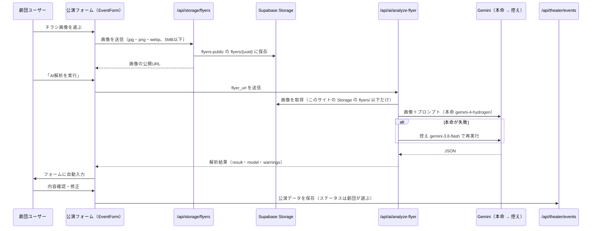
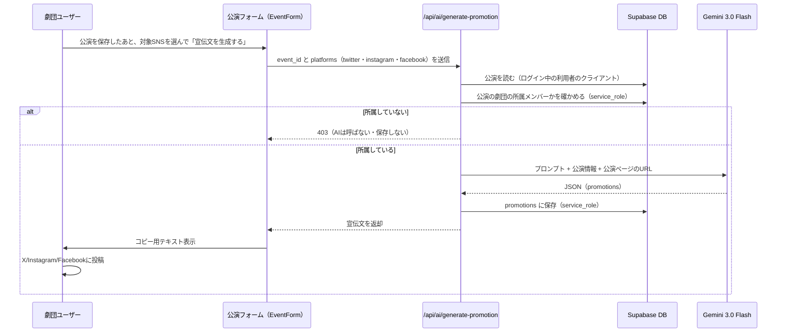
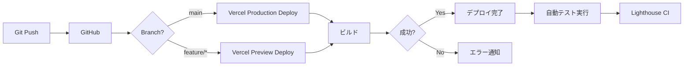
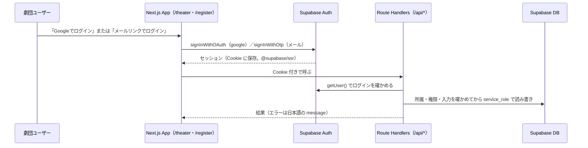

# アーキテクチャ設計書

## 1. システムアーキテクチャ概要

### 1.1 全体構成

```mermaid
graph TB
    Visitor[閲覧ユーザー]
    TheaterUser[劇団ユーザー]
    Admin[運営者]

    subgraph "フロントエンド（Vercel）"
        NextJS[Next.js 16 App Router\n(公開サイト + /theater)]
        TinaCMS[TinaCMS /admin（ブログ・固定ページ）]
    end

    subgraph "バックエンド・API"
        API[Next.js Route Handlers (/api/*)]
        EdgeFn[Supabase Edge Functions（必要に応じて）]
        GeminiAPI[Gemini API]
    end

    subgraph "データ層"
        Auth[Supabase Auth]
        Supabase[(Supabase PostgreSQL)]
        Storage[Supabase Storage]
        GitHub[(GitHub Repository)]
    end

    Visitor --> NextJS
    TheaterUser --> NextJS
    Admin --> TinaCMS

    NextJS --> Auth
    NextJS --> API
    NextJS --> Supabase
    NextJS --> Storage
    TinaCMS --> GitHub
    API --> GeminiAPI
    API --> EdgeFn
    EdgeFn --> Supabase
    API --> Storage
    GitHub -->|Auto Deploy| NextJS
```

### 1.2 技術スタック詳細

| レイヤー | 技術 | 責務 |
|----------|------|------|
| **フロントエンド** | Next.js 16 (App Router) | SSR/SSG、ルーティング、UI |
| **スタイリング** | Tailwind CSS | ユーティリティファーストCSS |
| **UI コンポーネント** | React 19 | コンポーネントベースUI |
| **CMS** | TinaCMS | Git-based コンテンツ管理 |
| **データベース** | Supabase (PostgreSQL) | 劇団・公演データ、PV集計、リダイレクト |
| **認証** | Supabase Auth | 劇団ログイン（Google OAuth + Magic Link）/ 運営者ログイン |
| **ストレージ** | Supabase Storage | チラシ画像、公演画像 |
| **AI - 画像解析** | Gemini（`gemini-4-hydrogen`、控え `gemini-3.8-flash`。`GEMINI_ANALYZE_MODELS` で変更可） | チラシ自動解析 |
| **AI - テキスト生成** | Gemini 3.0 Flash（`gemini-3.0-flash`） | SNS宣伝文生成 |
| **カレンダー** | 自前の番組表（`app/calendar/WeekTimetable.tsx`。FullCalendar は使わない） | 公演スケジュール表示 |
| **ホスティング** | Vercel | デプロイ、Edge Functions |
| **CDN** | Cloudflare | DNS、CDN |

---

## 2. Next.js App Router ディレクトリ構造

```
（リポジトリのルート）/
├── app/
│   ├── layout.tsx                 # ルートレイアウト（ヘッダー、フッター）
│   ├── page.tsx                   # トップページ（/）
│   ├── _components/               # 共通部品（ヘッダー・画像・サイト全体のタグの差し込み）
│   ├── events/
│   │   ├── page.tsx               # 公演一覧（/events/）
│   │   ├── archive/page.tsx       # 過去公演（/events/archive/）
│   │   └── [category]/
│   │       ├── page.tsx           # カテゴリー別公演一覧（/events/[category]/）
│   │       └── [slug]/
│   │           ├── page.tsx       # 公演詳細（/events/[category]/[slug]/）。旧URLの転送（308）もここで解決
│   │           ├── ViewCounter.tsx # PV計測（POST /api/views を呼ぶ）
│   │           └── edit/page.tsx  # 公開URLからの公演編集（劇団メンバー向け）
│   ├── blog/
│   │   ├── page.tsx               # ブログ一覧（/blog/）
│   │   └── [slug]/page.tsx        # ブログ記事詳細（/blog/[slug]/）
│   ├── calendar/
│   │   ├── page.tsx               # カレンダーページ（/calendar/）
│   │   └── WeekTimetable.tsx      # 会場×週の番組表
│   ├── register/page.tsx          # 劇団ログイン・劇団登録・招待（/register/）
│   ├── theater/
│   │   ├── layout.tsx             # 劇団ダッシュボード共通（要ログイン）
│   │   ├── page.tsx               # ダッシュボード（/theater/）
│   │   ├── events/
│   │   │   ├── _components/       # EventForm.tsx（公演フォーム）・EditEventScreen.tsx（編集画面）
│   │   │   ├── new/page.tsx       # 公演新規作成（/theater/events/new/）
│   │   │   └── [id]/page.tsx      # 公演編集（/theater/events/[id]/）
│   │   └── settings/page.tsx      # 劇団情報（/theater/settings/）
│   ├── admin/                     # 運営者画面（劇団の状態・下書きレビュー・問い合わせ・サイトタグ）
│   ├── about/page.tsx             # 運営者情報（/about/）
│   ├── contact/                   # お問い合わせ（/contact/）
│   ├── privacy-policy/page.tsx    # プライバシーポリシー（/privacy-policy/）
│   ├── sitemap.ts                 # 動的サイトマップ（/sitemap.xml）
│   ├── robots.ts                  # robots.txt（/robots.txt）
│   └── api/
│       ├── theater/               # 劇団向け: onboard・me・active・profile・invite・members・events・events/[id]
│       ├── ai/                    # analyze-flyer（チラシ解析）・generate-promotion（SNS宣伝文）
│       ├── storage/flyers/        # 画像アップロード
│       ├── views/                 # PV計測
│       ├── contact/               # お問い合わせ送信
│       ├── site-tags/             # サイト全体のタグ（公開）
│       └── admin/                 # 運営者向け: theaters/[id]・events/[id]・contact/[id]・site-tags
├── lib/
│   ├── supabase/
│   │   ├── client.ts              # ブラウザ用（ログイン画面）
│   │   ├── server.ts              # サーバー用（Cookieのセッション＝ログイン中の利用者）
│   │   ├── public.ts              # 公開ページ用（anon・Cookieなし）
│   │   └── service.ts             # service_role（サーバー内部の書き込み）
│   ├── theater/activeTheater.ts   # 所属と選択中の劇団
│   ├── data/                      # 公開ページのデータ取得（events.ts・calendar.ts・siteTags.ts）
│   ├── events/                    # 終演・noindex の判定（lifecycle.ts）・画像（image.ts）
│   ├── venues/normalize.ts        # 会場名の名寄せ
│   ├── event-slug.ts              # 公演URLの英字の形式検査（画面とAPIで共通）
│   └── search.ts・seo.ts・content.ts・color.ts
├── content/                       # TinaCMS のマークダウン（blog・pages）
├── tina/config.ts                 # TinaCMS 設定
├── supabase/migrations/           # 本番に流すマイグレーション（005〜）
├── docs/sql/                      # DBの土台（001〜004）と一部の写し（docs/sql/README.md）
├── scripts/                       # package.json から呼ぶ検証・ビルドのスクリプト、自動収集（harvest）
├── proxy.ts                       # /calendar?week= の範囲外の週を /calendar へ 308
├── next.config.ts
└── package.json
```

---

## 3. データベース設計（Supabase）

### 3.1 主なテーブル（詳細は `docs/03_database.md`）
- `theaters`, `theater_members`, `theater_invites`, `user_settings`, `admins`: 劇団の登録・状態・所属・招待・選択中の劇団、権限判定
- `events`: 公演（`/events/[category]/[slug]` 用に主カテゴリの `(category, slug)` 一意。`categories` はURLを持たないタグ）
- `event_redirects`: 旧URL→現行公演の転送（308）のマッピング（公開中の公演の主カテゴリ/slug変更時）
- `event_views_daily`: 直近30日PV集計（人気順/TRENDING用）
- `event_view_marks`: PVの重複よけの印（関数 `record_event_view` が使う）
- `promotions`: AI生成SNS宣伝文
- `categories`, `venues`: マスタ

### 3.2 書き込みと権限の守り方（要点）
- **書き込みは service_role ＋ APIの中の確認**: 劇団向けAPI（`app/api/theater/*`・`app/api/ai/generate-promotion`）は、ログイン・所属（選択中の劇団。宣伝文は公演の劇団）・オーナーだけの操作・入力の形（スラッグ・カテゴリ・料金）・ほかの公演の旧URLの予約・承認済みの劇団かを確かめてから、`service_role`（`lib/supabase/service.ts`）で書く。PV計測（`app/api/views`）・問い合わせ（`app/api/contact`）も service_role で書く。service_role は RLS の影響を受けない
- **RLS は最後の守り**: anon キーは公開されていて、ログインは誰でもできるので、ブラウザから PostgREST を直接叩いたときに書けないようにする。劇団メンバー向けの書き込みポリシーは置かず、`theaters`・`theater_members` の INSERT、`theater_invites`・`promotions` の読み書き、`events` の INSERT/UPDATE/DELETE は運営者（`is_admin()`）だけ
- 公開公演（`events.status='published'`）は匿名含め閲覧可（公開ページは anon キーの `lib/supabase/public.ts` で読む）
- `theaters.status != 'approved'` の劇団は公演を `published` にできない（APIが 403 で断る。`events` の運営者向けポリシーにも同じ条件がある）
- `event_views_daily` / `event_redirects` / `event_view_marks` は改ざん対策として **service_role** だけが読み書きする
- 運営者向けAPI（`app/api/admin/*`）は、ログイン中の利用者のクライアントで書き、RLS の `is_admin()` を通る（`site-tags` は service_role）
- ポリシーの一覧は `docs/03_database.md` の「6. Row Level Security (RLS)」

---

## 4. TinaCMS 統合

### 4.1 TinaCMS コンテンツスキーマ

```typescript
// tina/schema.ts
export default defineConfig({
  schema: {
    collections: [
      {
        name: "blog",
        label: "Blog Posts",
        path: "content/blog",
        fields: [
          {
            type: "string",
            name: "title",
            label: "Title",
            required: true,
          },
          {
            type: "string",
            name: "slug",
            label: "Slug",
            required: true,
          },
          {
            type: "datetime",
            name: "publishedAt",
            label: "Published At",
          },
          {
            type: "string",
            name: "excerpt",
            label: "Excerpt",
            ui: { component: "textarea" },
          },
          {
            type: "rich-text",
            name: "body",
            label: "Body",
            isBody: true,
          },
          {
            type: "image",
            name: "image",
            label: "Cover Image",
          },
          {
            type: "string",
            name: "category",
            label: "Category",
            options: ["福岡演劇情報", "劇場ガイド", "インタビュー", "レビュー"],
          },
          {
            type: "string",
            name: "tags",
            label: "Tags",
            list: true,
          },
        ],
      },
    ],
  },
});
```

### 4.2 ワークフロー
1. 管理者が `/admin` にアクセス
2. TinaCMS エディタでブログ記事を作成・編集
3. リアルタイムプレビュー確認
4. 「Save」ボタン → GitHub に自動コミット
5. GitHub Webhook → Vercel 自動デプロイ（1-2分）
6. サイトに反映

---

## 5. AI 機能フロー

### 5.1 チラシ画像解析フロー



- 公演ページURL（`page_url`）からの読み取りは、今は安全のため止めている（`page_url` だけを送ると 400）
- モデルは環境変数 `GEMINI_ANALYZE_MODELS`（カンマ区切り）で変えられる。先頭から順に試し、控えで読み取ったときは `warnings` に書く
- Gemini は SDK ではなく REST（`generativelanguage.googleapis.com` の `generateContent`）を `fetch` で呼ぶ（`app/api/ai/analyze-flyer/route.ts`）。上流のエラーの本文はログにも応答にも入れない（HTTPステータスと決まった識別子だけ）
- 詳細（入力・応答・エラー）は `docs/04_api.md` の「5.1」

---

### 5.2 SNS宣伝文生成フロー



- 公演の情報（タイトル・劇団・日程・会場・料金・カテゴリ・あらすじ）は、画面からではなく API がDBから読む
- 所属の確認は「選択中の劇団」ではなく「公演の劇団」で行う（所属しているほかの劇団の公演でも作れる）
- Gemini は REST（`generateContent`）を `fetch` で呼ぶ（モデル `gemini-3.0-flash`）。レート制限は 5回/分（ユーザー×IP）
- 詳細（入力・応答・エラー）は `docs/04_api.md` の「5.2」

---

## 6. デプロイ構成

### 6.1 環境構成

| 環境 | URL | 用途 |
|------|-----|------|
| **Production** | `https://fukuoka-stage.com` | 本番環境（Vercel） |
| **Preview** | `https://fukuoka-stage-*.vercel.app` | PR毎のプレビュー環境 |
| **Development** | `http://localhost:3000` | ローカル開発環境 |

### 6.2 環境変数

```bash
# .env.local（ローカル開発）
NEXT_PUBLIC_SUPABASE_URL=https://xxx.supabase.co
NEXT_PUBLIC_SUPABASE_ANON_KEY=eyJxxx...
SUPABASE_SERVICE_ROLE_KEY=eyJxxx...

GEMINI_API_KEY=AIzaSyxxx...
# 任意: チラシ解析のモデル（カンマ区切り。無ければ gemini-4-hydrogen,gemini-3.8-flash）
GEMINI_ANALYZE_MODELS=
# 任意: PVの閲覧者の印（HMAC）の鍵。無ければ SUPABASE_SERVICE_ROLE_KEY を使う
VIEW_HASH_SECRET=

RECAPTCHA_SITE_KEY=xxx...
RECAPTCHA_SECRET_KEY=xxx...
RESEND_API_KEY=re_...
CONTACT_TO_EMAIL=contact@example.com
CONTACT_FROM_EMAIL=福岡アクトポータル <no-reply@example.com>

TINA_TOKEN=xxx...
NEXT_PUBLIC_TINA_CLIENT_ID=xxx...

NEXT_PUBLIC_SITE_URL=http://localhost:3000
```

**Vercel 環境変数設定**:
- Production: 本番用Supabase、Gemini API キー
- Preview: 開発用Supabase、同じGemini API キー（テスト用）

### 6.3 CI/CD パイプライン



---

## 7. セキュリティアーキテクチャ

### 7.1 認証フロー（Supabase Auth）



- ログイン中の利用者のクライアント（`lib/supabase/server.ts`）でDBを書くのは運営者向けAPIだけ（RLS の `is_admin()` を通る）
- 劇団メンバーがブラウザから anon キーで直接DBを書くことは、RLS でできない（`docs/03_database.md` の「6.」）

### 7.2 API セキュリティ

#### Rate Limiting（各APIのメモリ上）
- 各 Route Handler が、サーバーのメモリ上の `Map` で1分あたりの回数を数える（インスタンスごとに別。外部のストアは使わない）
  - チラシ解析 10回・宣伝文 5回・画像アップロード 10回（ユーザー×IP）、PV 60回（IP×公演）、問い合わせ 5回（IP）
- `proxy.ts` はレート制限をしない（`/calendar?week=` の範囲外の週を `/calendar` へ 308 で送るだけ）

#### PVの水増し対策
- `POST /api/views` は `Content-Type: application/json` だけを受け、DB関数 `record_event_view` で「同じ閲覧者・公演・日は1回」「同じ IP・公演・日は5回まで」に絞る（`docs/04_api.md` の「6.」）

---

## 8. パフォーマンス最適化

### 8.1 レンダリング戦略

| ページ | レンダリング戦略 | 理由 |
|--------|------------------|------|
| トップページ | **ISR（600秒）** | 公演情報を短い間隔で更新 |
| 公演一覧 | **SSR** | SEO重視、リアルタイム更新 |
| 公演詳細 | **ISR（600秒）** | SEO最適化、キャッシュ効率化 |
| ブログ一覧 | **SSG + ISR（300秒）** | 静的生成で高速化 |
| ブログ詳細 | **SSG + ISR（300秒）** | 静的生成で高速化 |
| カレンダー | **ISR（600秒）・サーバーで描画** | 会場×週の番組表 |
| 劇団ログイン/オンボーディング | **CSR** | 認証、フォーム送信 |
| 劇団ダッシュボード | **CSR** | フォーム中心、権限付き操作 |

**ISR とデータのキャッシュ**:
```typescript
// app/events/[category]/[slug]/page.tsx（generateStaticParams は無い）
export const revalidate = 600;
```
- 公開ページのデータは `lib/data/events.ts` の `unstable_cache`（タグ `events`・`event:{id}`、600秒など）でキャッシュする
- 公演の保存API（`app/api/theater/events`・`[id]`、`app/api/admin/events/[id]`）は `revalidateTag("events")`・`revalidateTag("event:{id}")`（`{ expire: 0 }`）で、保存後すぐに反映する

### 8.2 画像最適化

```typescript
// components/ui/EventCard.tsx
import Image from 'next/image';

<Image
  src={event.image_url}
  alt={event.title}
  width={600}
  height={400}
  loading="lazy"
  placeholder="blur"
  blurDataURL="/placeholder.jpg"
  sizes="(max-width: 768px) 100vw, (max-width: 1024px) 50vw, 33vw"
/>
```

---

## 9. 技術的決定事項（ADR）

### 9.1 なぜ Next.js を選んだのか？
- **SEO最適化**: SSR/SSGでGoogle検索に最適
- **パフォーマンス**: Image Optimization、Code Splitting自動化
- **開発体験**: App Router、TypeScript、ホットリロード
- **エコシステム**: Vercel、TinaCMS との統合が簡単

### 9.2 なぜ Supabase を選んだのか？
- **無料プラン**: 500MB DB、1GB ストレージ（初期は十分）
- **Row Level Security**: データベースレベルのセキュリティ
- **リアルタイムAPI**: 将来的な拡張性
- **認証**: Supabase Auth でシンプルな実装
- **PostgreSQL**: 信頼性の高いRDBMS

### 9.3 なぜ TinaCMS を選んだのか？
- **Git-based**: コンテンツがバージョン管理される
- **WordPress風UI**: `/admin`で直感的な編集
- **無料プラン**: 2ユーザーまで無料
- **Next.js統合**: 公式サポート、設定が簡単

### 9.4 なぜ Gemini API を選んだのか？
- **高精度**: Gemini 2.5 Flash で90-95%精度（チラシ解析）
- **コスパ**: Flash は ¥0.05-0.1/画像（GPT-4o Vision の1/15）
- **ハイブリッド戦略**: Flash → Pro フォールバックで精度担保
- **テキスト生成**: Gemini 3.0 Flash でSNS宣伝文も高品質

---

**作成日**: 2026-01-31  
**最終更新日**: 2026-11-27  
**バージョン**: 2.1  
**作成者**: Claude Code (AI Assistant)
