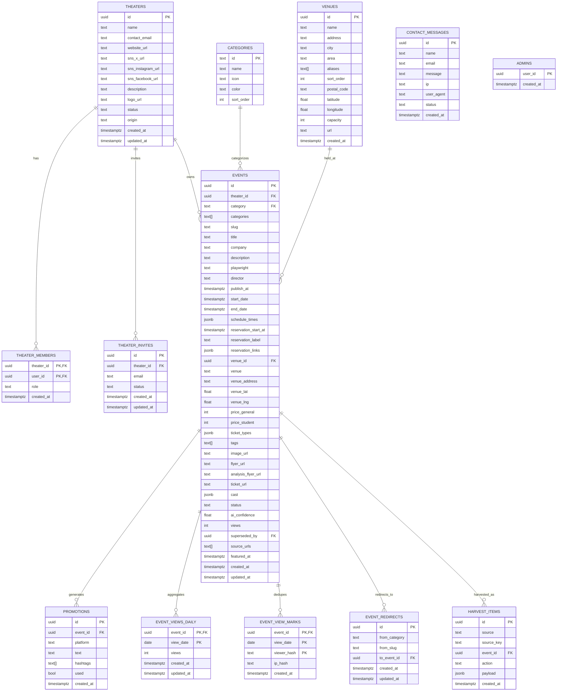

# データベース設計書

## 1. データベース概要

### 1.1 基本情報
- **DBMS**: PostgreSQL 17（Supabase・2026-11-27 時点の本番は 17.6）
- **文字コード**: UTF-8
- **タイムゾーン**: Asia/Tokyo (JST)
- **接続方式**: Supabase Client SDK、Row Level Security (RLS)

### 1.2 本書の前提（要件との対応）
- ブログ/固定ページは **TinaCMS（Git管理）** を利用し、DBには保持しない（公演・劇団データはDBで管理）
- 公演の承認フローは **無し**（劇団が作成・編集・削除できる）
- 劇団には **状態（`theaters.status`）** がある。劇団登録は `approved` で作る（即承認）。運営者が `pending`・`rejected`・`suspended` に変えられ、`approved` でない劇団は公演を **公開（published）できない**
- 人気順（PV）は **直近30日PV** を指標とするため、DBで日次集計を保持する
- 公演URLは `/events/[category]/[slug]`（`category` は主カテゴリ）。公開中の公演の主カテゴリ/slugを変えると旧URLを `event_redirects` に登録し、公開ページが **308** で転送する
- アプリの書き込みは、APIの中で確かめてから **service_role** で行う。RLSは、ブラウザから公開の anon キーで直接書けないようにする最後の守り（「6. Row Level Security (RLS)」）

---

## 2. テーブル一覧

| テーブル名 | 説明 | レコード数想定 |
|------------|------|----------------|
| `categories` | カテゴリーマスタ | 12件（公演フォームの選択肢と同じ） |
| `venues` | 会場マスタ | 20-100件 |
| `theaters` | 劇団（状態を含む） | 50-300件 |
| `theater_members` | 劇団メンバー（auth.usersとの紐づけ） | theaters × 1-2 |
| `theater_invites` | 劇団メンバーの招待（2人目のメール） | theaters × 0-1 |
| `user_settings` | 利用者ごとの選択中の劇団 | 劇団ユーザー数 |
| `admins` | 運営者アカウント | 数名 |
| `events` | 公演情報 | 100-500件/年 |
| `event_redirects` | 旧URL→現行公演の転送（308）のマッピング | 公演更新に応じて増加 |
| `event_views_daily` | 公演の日次PV集計 | events × 日数 |
| `event_view_marks` | PVの重複よけの印（当日分だけ残す） | 直近2日の閲覧数 |
| `promotions` | AI生成SNS宣伝文 | events × 3（SNS種類） |
| `contact_messages` | お問い合わせ | 100-1000件/年 |
| `site_settings` | サイト全体に入れるタグ（1行だけ） | 1件 |
| `harvest_items` | 公演情報の自動収集（harvest）の台帳 | 収集件数に応じて増加 |

`user_settings` を作るSQLは、`docs/sql/`・`supabase/migrations/` のどちらにも無い（`lib/theater/activeTheater.ts` が `user_id`・`active_theater_id`・`updated_at` を読み書きする）。

---

## 3. ER図



---

## 4. テーブル定義詳細

### 4.1 `admins` テーブル（運営者）

運営者権限をDB側で判定するための最小テーブル。

| カラム名 | 型 | NULL | デフォルト | 制約 | 説明 |
|----------|-------|------|------------|------|------|
| `user_id` | UUID | NO | - | PRIMARY KEY（auth.users参照） | Supabase AuthユーザーID |
| `created_at` | TIMESTAMPTZ | NO | `NOW()` | | 登録日時 |

---

### 4.2 `theaters` テーブル（劇団）

| カラム名 | 型 | NULL | デフォルト | 制約 | 説明 |
|----------|-------|------|------------|------|------|
| `id` | UUID | NO | `gen_random_uuid()` | PRIMARY KEY | 劇団ID |
| `name` | TEXT | NO | - | 一意（大文字小文字を区別しない） | 劇団名 |
| `contact_email` | TEXT | NO | - | | 連絡先メール |
| `website_url` | TEXT | YES | NULL | | 公式サイトURL |
| `sns_x_url` | TEXT | YES | NULL | | X URL |
| `sns_instagram_url` | TEXT | YES | NULL | | Instagram URL |
| `sns_facebook_url` | TEXT | YES | NULL | | Facebook URL |
| `description` | TEXT | YES | NULL | | 紹介文 |
| `logo_url` | TEXT | YES | NULL | | ロゴ画像URL（Storage） |
| `status` | TEXT | NO | `'approved'` | CHECK | 状態（`pending`, `approved`, `rejected`, `suspended`）。劇団登録は `approved`。変えられるのは運営者と service_role だけ（トリガー） |
| `origin` | TEXT | NO | `'self'` | CHECK | `self`（劇団自身が登録）/ `scout`（AIが自動作成した劇団） |
| `created_at` | TIMESTAMPTZ | NO | `NOW()` | | 作成日時 |
| `updated_at` | TIMESTAMPTZ | NO | `NOW()` | | 更新日時（トリガーで自動更新） |

**インデックス**:
```sql
CREATE INDEX idx_theaters_status ON theaters(status);
CREATE UNIQUE INDEX uniq_theaters_name_ci ON theaters (lower(name));
```

---

### 4.3 `theater_members` テーブル（劇団メンバー）

| カラム名 | 型 | NULL | デフォルト | 制約 | 説明 |
|----------|-------|------|------------|------|------|
| `theater_id` | UUID | NO | - | PK, FK → theaters.id | 劇団ID |
| `user_id` | UUID | NO | - | PK（auth.users参照） | ユーザーID |
| `role` | TEXT | NO | `'owner'` | CHECK | 権限（`owner`＝劇団を登録した人, `editor`＝招待で入った人） |
| `created_at` | TIMESTAMPTZ | NO | `NOW()` | | 登録日時 |

- 1人が複数の劇団に所属できる。所属を足すのは劇団登録（`owner`）と招待の受諾（`editor`）で、どちらも service_role

**インデックス**:
```sql
CREATE INDEX idx_theater_members_user_id ON theater_members(user_id);
```

---

### 4.4 `categories` テーブル（カテゴリーマスタ）

| カラム名 | 型 | NULL | デフォルト | 制約 | 説明 |
|----------|-------|------|------------|------|------|
| `id` | TEXT | NO | - | PRIMARY KEY | カテゴリーID（例: `comedy`） |
| `name` | TEXT | NO | - | | カテゴリー名（例: `コメディ`） |
| `icon` | TEXT | YES | NULL | | アイコン名（Emoji or SVG名） |
| `color` | TEXT | YES | NULL | | カラーコード（例: `#FFD93D`） |
| `description` | TEXT | YES | NULL | | 説明文 |
| `sort_order` | INTEGER | NO | 0 | | 表示順序 |

#### データ
劇団の公演フォーム（`app/theater/events/_components/EventForm.tsx`）とチラシ解析（`app/api/ai/analyze-flyer`）が使うカテゴリは12件:
`comedy`・`conversation`・`musical`・`classic`・`action`・`serious`・`drama`・`dance`・`student`・`conte`・`experimental`・`other`

`docs/sql/001_init.sql` の初期データは次の9件で、`action`・`drama`・`serious` の行を作るSQLはリポジトリに無い（色だけ `supabase/migrations/20260712151000_categories_colors.sql` が付ける）。
```sql
INSERT INTO categories (id, name, icon, color, sort_order) VALUES
  ('comedy', 'コメディ', '😂', '#FFD93D', 1),
  ('conversation', '会話劇', '💬', '#FF6B9D', 2),
  ('musical', 'ミュージカル', '🎵', '#A78BFA', 3),
  ('classic', '古典・時代劇', '🏯', '#6BCF7F', 4),
  ('dance', 'ダンス', '💃', '#4ECDC4', 5),
  ('student', '学生演劇', '🎓', '#FFB74D', 6),
  ('conte', 'コント', '🎭', '#FF8A80', 7),
  ('experimental', '実験的', '🔬', '#B39DDB', 8),
  ('other', 'その他', '📌', '#90A4AE', 99);
```

---

### 4.5 `venues` テーブル（会場マスタ）

| カラム名 | 型 | NULL | デフォルト | 制約 | 説明 |
|----------|-------|------|------------|------|------|
| `id` | UUID | NO | `gen_random_uuid()` | PRIMARY KEY | 会場ID |
| `name` | TEXT | NO | - | | 会場名 |
| `address` | TEXT | YES | NULL | | 住所 |
| `city` | TEXT | NO | `'福岡市'` | | 市区町村 |
| `area` | TEXT | YES | NULL | | エリア表示（`lib/data/calendar.ts` の `AREA_ORDER` と同じ文字列） |
| `aliases` | TEXT[] | NO | `'{}'` | | 表記ゆれ（会場名の名寄せに使う） |
| `sort_order` | INTEGER | NO | 100 | | 表示順序 |
| `postal_code` | TEXT | YES | NULL | | 郵便番号 |
| `latitude` | FLOAT | YES | NULL | | 緯度 |
| `longitude` | FLOAT | YES | NULL | | 経度 |
| `capacity` | INTEGER | YES | NULL | | 収容人数 |
| `url` | TEXT | YES | NULL | | 公式サイトURL |
| `created_at` | TIMESTAMPTZ | NO | `NOW()` | | 作成日時 |

---

### 4.6 `events` テーブル（公演情報）

#### カラム定義
| カラム名 | 型 | NULL | デフォルト | 制約 | 説明 |
|----------|-------|------|------------|------|------|
| `id` | UUID | NO | `gen_random_uuid()` | PRIMARY KEY | 公演ID |
| `theater_id` | UUID | NO | - | FK → theaters.id | 劇団ID（APIの所有確認・RLSのSELECTに使用） |
| `category` | TEXT | NO | `'other'` | FK → categories.id | **主カテゴリ**。URL `/events/{category}/{slug}` に使う |
| `categories` | TEXT[] | YES | `'{}'` | | 2つ目からのカテゴリも含むカテゴリの配列（APIは主カテゴリを先頭に入れて保存）。一覧の絞り込み・表示に使う **タグで、URLを決めない** |
| `slug` | TEXT | NO | - | UNIQUE（複合） | URL用の英字。形式（英小文字・数字・ハイフン、1〜80文字）はDBではなくAPI（`lib/event-slug.ts`）で確かめる |
| `title` | TEXT | NO | - | | 公演タイトル |
| `company` | TEXT | NO | - | | 劇団名（表示用、theaters.nameのスナップショット。劇団名を変えるとAPIが書き換える） |
| `description` | TEXT | YES | NULL | | あらすじ（1000文字程度） |
| `playwright` | TEXT | YES | NULL | | 脚本 |
| `director` | TEXT | YES | NULL | | 演出 |
| `publish_at` | TIMESTAMPTZ | YES | NULL | | 情報公開日時（未来なら、その時刻まで公開ページに出さない） |
| `start_date` | TIMESTAMPTZ | NO | - | | 開始日時（タイムゾーン付き） |
| `end_date` | TIMESTAMPTZ | YES | NULL | | 終了日時（単日公演の場合NULL） |
| `schedule_times` | JSONB | YES | `'[]'` | | 公演日時の配列（`start_date`・`end_date`・`label`）。あればAPIが `start_date`・`end_date` をここから決める |
| `reservation_start_at` | TIMESTAMPTZ | YES | NULL | | 予約開始日時 |
| `reservation_label` | TEXT | YES | NULL | | 予約の表示名 |
| `reservation_links` | JSONB | YES | `'[]'` | | 販売所・予約窓口の配列（`label`・`url`） |
| `venue_id` | UUID | YES | NULL | FK → venues.id | 会場マスタ参照（任意。APIが `venue` から自動で入れる） |
| `venue` | TEXT | YES | NULL | | 会場名（表示用、任意） |
| `venue_address` | TEXT | YES | NULL | | 会場住所 |
| `venue_lat` | FLOAT | YES | NULL | | 会場緯度（Googleマップ用） |
| `venue_lng` | FLOAT | YES | NULL | | 会場経度（Googleマップ用） |
| `price_general` | INTEGER | YES | NULL | | 一般料金（円の整数。APIが小数・負の数を断る） |
| `price_student` | INTEGER | YES | NULL | | 学生料金（円の整数） |
| `ticket_types` | JSONB | YES | `'[]'` | | 券種の配列（`label`・`price`・`note`） |
| `tags` | TEXT[] | YES | `'{}'` | | タグ配列（例: `{"笑い度98%", "学生歓迎"}`） |
| `image_url` | TEXT | YES | NULL | | メインビジュアルURL（Storage） |
| `flyer_url` | TEXT | YES | NULL | | チラシ画像URL（Storage・公開表示用） |
| `analysis_flyer_url` | TEXT | YES | NULL | | AI解析専用のチラシ画像URL（裏面など。公開表示には使わない） |
| `ticket_url` | TEXT | YES | NULL | | チケット購入URL（外部サイト） |
| `cast` | JSONB | YES | `'[]'` | | キャスト情報（JSON配列）※SQLでは予約語のため `"cast"` で定義 |
| `status` | TEXT | NO | `'draft'` | CHECK | ステータス（`draft`, `published`, `archived`） |
| `ai_confidence` | FLOAT | YES | NULL | CHECK (0 <= ai_confidence <= 1) | AI解析信頼度スコア（0-1） |
| `views` | INTEGER | NO | 0 | | 累計PV（内部指標）。アプリ（`app/`・`lib/`）で加算するのは `record_event_view` だけ。人気順には使わない（人気順は `event_views_daily`） |
| `superseded_by` | UUID | YES | NULL | FK → events.id（ON DELETE SET NULL） | 再演時の後継公演。設定すると詳細ページの canonical が後継公演のURLになる |
| `source_urls` | TEXT[] | NO | `'{}'` | | AIスカウトが参照した出典URL |
| `featured_at` | TIMESTAMPTZ | YES | NULL | | トップのPICK UP枠に固定する指定日時（最新を採用） |
| `created_at` | TIMESTAMPTZ | NO | `NOW()` | | 作成日時 |
| `updated_at` | TIMESTAMPTZ | NO | `NOW()` | | 更新日時（トリガーで自動更新） |

#### 一意性（URL）
URLが `/events/[category]/[slug]` のため、以下を満たす必要がある：
- `UNIQUE(category, slug)`（主カテゴリの組だけ。`categories` の組は一意にしない）

```sql
CREATE UNIQUE INDEX uniq_events_category_slug ON events(category, slug);
```

#### カテゴリの考え方
- 公演のURLは主カテゴリの `/events/{category}/{slug}` の1つだけ
- `categories` はタグ。カテゴリ別の一覧は `category` の一致か `categories` に含むもので絞り込む（`lib/data/events.ts`）
- 公開ページで `/events/{categories の1つ}/{slug}` を開いたときは、転送（`event_redirects`）を先に見てから、主カテゴリのURLへ 308 で送る（4.7）

#### インデックス
```sql
CREATE INDEX idx_events_theater_id ON events(theater_id);
CREATE INDEX idx_events_status ON events(status);
CREATE INDEX idx_events_start_date ON events(start_date);
CREATE INDEX idx_events_category ON events(category);
CREATE INDEX idx_events_categories_gin ON events USING GIN (categories);
CREATE INDEX idx_events_publish_at ON events(publish_at);
CREATE INDEX idx_events_reservation_start_at ON events(reservation_start_at);
CREATE INDEX idx_events_superseded_by ON events(superseded_by);
```

#### `cast` JSONB 構造例
```json
[
  { "name": "山田太郎", "role": "主人公", "image_url": "https://..." },
  { "name": "佐藤花子", "role": "ヒロイン", "image_url": "https://..." }
]
```

---

### 4.7 `event_redirects` テーブル（旧URLの転送）

公演の旧URL `(from_category, from_slug)` → 現行の公演 `to_event_id` の対応。公開ページはこの表を見て、公演の今のURLへ **308** で転送する。

| カラム名 | 型 | NULL | デフォルト | 制約 | 説明 |
|----------|-------|------|------------|------|------|
| `id` | UUID | NO | `gen_random_uuid()` | PRIMARY KEY | リダイレクトID |
| `from_category` | TEXT | NO | - | | 旧カテゴリ |
| `from_slug` | TEXT | NO | - | | 旧スラッグ |
| `to_event_id` | UUID | YES | NULL | FK → events.id（ON DELETE SET NULL） | 転送先の公演（公演を削除するとNULLになる） |
| `created_at` | TIMESTAMPTZ | NO | `NOW()` | | 作成日時 |
| `updated_at` | TIMESTAMPTZ | NO | `NOW()` | | 更新日時（トリガーで自動更新） |

```sql
CREATE UNIQUE INDEX uniq_event_redirects_from ON event_redirects(from_category, from_slug);
CREATE INDEX idx_event_redirects_to_event_id ON event_redirects(to_event_id);
```

**使い方**:
- アプリ（`app/`・`lib/`）で登録するのは、劇団の公演更新（`PATCH /api/theater/events/{id}`・service_role）だけ。主カテゴリの組 `(category, slug)` が変わり、保存前の公演が公開ページに出ていた（`published` で、`publish_at` が空か過去）ときだけ、保存前の主カテゴリの組を1行登録する。`categories` の組は登録しない
- **上書きしない**: その組がすでにほかの公演への転送として登録されていれば、そのまま残す（ほかの公演の旧URLを奪わない）。転送先がNULLの行（転送先の公演が削除済み）だけ、この公演に向け直す
- 予約: 劇団が公演を作成・更新するとき、保存後の主カテゴリの組がほかの公演への転送として登録されていれば、409（`SLUG_RESERVED`）で断る。NULLの行は数えない。自分への転送（自分の旧URLに戻す）は使える
- 公開ページ（`app/events/[category]/[slug]/page.tsx`）の解決順:
  1. 主カテゴリが一致する公開中の公演 → そのまま表示
  2. `event_redirects` の `(category, slug)` → 転送先の今のURLへ 308（転送先が下書き・非公開・公開日前なら 404。転送先の今のURLがこのURLそのものなら、次へ進む）
  3. 同じ slug の公開中の公演（主カテゴリは違う。`categories` にこのカテゴリを含む公演が先）→ その公演の正式URLへ 308
  4. どれも無ければ 404
- 既存の行（2つ目からのカテゴリの組の行も含む）は消さない。そのまま 2 で効く

---

### 4.8 `event_views_daily` テーブル（日次PV集計）

直近30日PVのため、日次で集計を保持する（人気順・TRENDING・劇団の公演一覧の `views_30`）。

| カラム名 | 型 | NULL | デフォルト | 制約 | 説明 |
|----------|-------|------|------------|------|------|
| `event_id` | UUID | NO | - | PK, FK → events.id | 公演ID |
| `view_date` | DATE | NO | - | PK | 集計日（JST日付） |
| `views` | INTEGER | NO | 0 | CHECK (views >= 0) | 当日PV |
| `created_at` | TIMESTAMPTZ | NO | `NOW()` | | 作成日時 |
| `updated_at` | TIMESTAMPTZ | NO | `NOW()` | | 更新日時（トリガーで自動更新） |

```sql
CREATE INDEX idx_event_views_daily_view_date ON event_views_daily(view_date);
```

- アプリ（`app/`・`lib/`）で加算するのは関数 `record_event_view` だけ（`POST /api/views` から service_role で呼ぶ）

---

### 4.9 `event_view_marks` テーブル（PVの重複よけの印）

`supabase/migrations/20261127150021_event_view_dedupe.sql` で追加。同じ閲覧者・同じ公演・同じ日（JST）の閲覧を1回だけ数えるための印。

| カラム名 | 型 | NULL | デフォルト | 制約 | 説明 |
|----------|-------|------|------------|------|------|
| `event_id` | UUID | NO | - | PK, FK → events.id（ON DELETE CASCADE） | 公演ID |
| `view_date` | DATE | NO | - | PK | 閲覧日（JST日付） |
| `viewer_hash` | TEXT | NO | - | PK, CHECK（64桁の16進） | 閲覧者の印（IP＋User-Agent＋日付の HMAC-SHA256） |
| `ip_hash` | TEXT | NO | - | CHECK（64桁の16進） | IPの印（IP＋日付の HMAC-SHA256）。同じIPの上限を数える |
| `created_at` | TIMESTAMPTZ | NO | `NOW()` | | 作成日時 |

```sql
CREATE INDEX idx_event_view_marks_view_date ON event_view_marks(view_date);
CREATE INDEX idx_event_view_marks_event_date_ip ON event_view_marks(event_id, view_date, ip_hash);
```

- 生の IP・User-Agent は持たない（HMACの鍵は `VIEW_HASH_SECRET`、無ければ `SUPABASE_SERVICE_ROLE_KEY`。`app/api/views/route.ts`）
- 古い印（`view_date` が2日以上前）は `record_event_view` が新しく数えたときに消す

---

### 4.10 `promotions` テーブル（AI生成SNS宣伝文）

| カラム名 | 型 | NULL | デフォルト | 制約 | 説明 |
|----------|-------|------|------------|------|------|
| `id` | UUID | NO | `gen_random_uuid()` | PRIMARY KEY | 宣伝文ID |
| `event_id` | UUID | NO | - | FK → events.id（ON DELETE CASCADE） | 公演ID |
| `platform` | TEXT | NO | - | CHECK | SNS（`twitter`, `instagram`, `facebook`） |
| `text` | TEXT | NO | - | | 宣伝文 |
| `hashtags` | TEXT[] | YES | `'{}'` | | ハッシュタグ配列 |
| `used` | BOOLEAN | NO | FALSE | | 使用済みフラグ |
| `created_at` | TIMESTAMPTZ | NO | `NOW()` | | 作成日時 |

- アプリ（`app/`・`lib/`）で書くのは `POST /api/ai/generate-promotion`（service_role）だけ

---

### 4.11 `contact_messages` テーブル（お問い合わせ）

| カラム名 | 型 | NULL | デフォルト | 制約 | 説明 |
|----------|-------|------|------------|------|------|
| `id` | UUID | NO | `gen_random_uuid()` | PRIMARY KEY | ID |
| `name` | TEXT | NO | - | | お名前 |
| `email` | TEXT | NO | - | | メールアドレス |
| `message` | TEXT | NO | - | | お問い合わせ内容 |
| `ip` | TEXT | YES | NULL | | 送信元IP |
| `user_agent` | TEXT | YES | NULL | | User-Agent |
| `status` | TEXT | NO | `'new'` | CHECK | new / read / archived |
| `created_at` | TIMESTAMPTZ | NO | `NOW()` | | 作成日時 |

---

### 4.12 `theater_invites` テーブル（劇団メンバーの招待）

`docs/sql/003_update_theater_rules.sql` で追加。

| カラム名 | 型 | NULL | デフォルト | 制約 | 説明 |
|----------|-------|------|------------|------|------|
| `id` | UUID | NO | `gen_random_uuid()` | PRIMARY KEY | 招待ID |
| `theater_id` | UUID | NO | - | FK → theaters.id（ON DELETE CASCADE） | 劇団ID |
| `email` | TEXT | NO | - | | 招待するメール（APIが前後の空白を除き小文字にして保存） |
| `status` | TEXT | NO | `'pending'` | CHECK | `pending`, `accepted`, `revoked` |
| `created_at` | TIMESTAMPTZ | NO | `NOW()` | | 作成日時 |
| `updated_at` | TIMESTAMPTZ | NO | `NOW()` | | 更新日時（トリガーで自動更新） |

```sql
CREATE UNIQUE INDEX uniq_theater_invites_email ON theater_invites (theater_id, lower(email));
CREATE INDEX idx_theater_invites_email ON theater_invites (lower(email));
```

- 作るのは劇団の `owner` だけ（`POST /api/theater/invite`）。劇団ごとに所属＋保留中の招待は2件まで
- 受諾は、招待されたメールでログインした人が `GET /api/theater/me` を呼んだとき（メールの完全一致）

---

### 4.13 そのほかのテーブル

| テーブル | 定義 | 内容 |
|----------|------|------|
| `user_settings` | リポジトリにSQLなし | 利用者ごとの選択中の劇団（`user_id` で1行。`active_theater_id`・`updated_at`）。`lib/theater/activeTheater.ts` が service_role で読み書きする |
| `site_settings` | `docs/sql/004_site_settings.sql` | `id = 1` の1行だけ。`head_tag`・`body_start_tag`・`body_end_tag`（サイト全体に入れるタグ） |
| `harvest_items` | `supabase/migrations/20260802180015_harvest_infra.sql` | 自動収集の台帳。`(source, source_key)` で一意。`event_id` は公演の削除でNULL |

---

## 5. マイグレーション（SQLファイルと流す順番）

- テーブル・関数・RLSを作るSQLの正本は、`docs/sql/` の土台（`001`〜`004`）と `supabase/migrations/`（`005` から）
- 本番に流すのは `supabase/migrations/`。`docs/sql/` には一部の写しもある
- 空のDBを作る順番・番号ごとの対応・写しの無い番号は `docs/sql/README.md` を見る（`docs/sql/006`・`007` は `supabase/migrations/` に無いので手で流す）
- `updated_at` の自動更新トリガー（`update_updated_at_column()`）は `theaters`・`events`・`event_redirects`・`event_views_daily`（`001_init.sql`）、`theater_invites`（`003`）、`site_settings`（`004`）に付いている
- 検索用の `pg_trgm` 索引はどのSQLにも無い。公演の検索は `title`・`venue`・`company` の ILIKE（`lib/search.ts`・`lib/data/events.ts`）

---

## 6. Row Level Security (RLS)

### 6.0 方針
- アプリのDBへの書き込みは、ほぼすべて **service_role**（`lib/supabase/service.ts`）で行い、ログイン・所属・権限・入力の形はAPIの中で確かめる。service_role はRLSの影響を受けない
- RLSは、公開されている anon キーとログイン（誰でもできる）だけでブラウザから PostgREST を直接叩いたときに、書き込めないようにする **最後の守り**。そのため劇団メンバー向けの書き込みポリシーは置かず、書き込みは運営者（`is_admin()`）だけにしている
- ログイン中の利用者のクライアント（`lib/supabase/server.ts`）で書いているのは、運営者向けAPI（`app/api/admin/theaters`・`events`・`contact`）だけで、`is_admin()` のポリシーを通る
- 公開ページの読み取りは anon キー（`lib/supabase/public.ts`）で、公開ポリシーが許すデータだけを読む
- 下の内容は `docs/sql/001`・`003`・`004` と `supabase/migrations/`（`20261127120018`・`130019`・`140020`・`150021` を含む）を順に流した結果。`001_init.sql` にあって、あとで消したポリシーは書いていない

### 6.1 関数

| 関数 | 定義 | 内容 |
|------|------|------|
| `is_admin()` | `001_init.sql` | `admins` に `auth.uid()` の行があるか |
| `is_theater_member(target_theater_id uuid)` | `001_init.sql` | `theater_members` に `(target_theater_id, auth.uid())` の行があるか |
| `prevent_theater_status_update()` | `001_init.sql` | トリガー `trg_prevent_theater_status_update`（theaters の BEFORE UPDATE）。`status` を変えられるのは `is_admin()` か `auth.role() = 'service_role'` だけ |
| `update_updated_at_column()` | `001_init.sql` | `updated_at` の自動更新トリガー |
| `trending_events(days int DEFAULT 30, max_rows int DEFAULT 20)` | `supabase/migrations/20260712130008_trending_rpc.sql` | 公開中の公演の直近N日PVの合計を多い順に返す。SECURITY DEFINER・`search_path = public`。`lib/data/events.ts` が service_role で呼ぶ |
| `record_event_view(p_event_id uuid, p_view_date date, p_viewer_hash text, p_ip_hash text, p_ip_limit integer)` | `supabase/migrations/20261127150021_event_view_dedupe.sql` | 下の 6.1.1 |

#### 6.1.1 `record_event_view`
閲覧を1回数える。数えたら `true`、数えなければ `false`。`POST /api/views` が service_role で1回呼ぶ（`p_ip_limit` は5）。
1. `p_ip_limit` が NULL か1未満なら例外
2. 同じ (公演, 日, `p_ip_hash`) の呼び出しを `pg_advisory_xact_lock` で1本ずつにする（同時に来ても上限を超えない）
3. 同じ公演・日・IPの印が `p_ip_limit` 件以上あれば `false`
4. `event_view_marks` に印を INSERT … ON CONFLICT DO NOTHING。入らなければ（同じ閲覧者・公演・日がもうある）`false`
5. `event_views_daily` を (event_id, view_date) で upsert して +1（無い行は views = 1）、`events.views` を `coalesce(views, 0) + 1`。どちらも1文で加算する（読んでから書かない）
6. `view_date` が `p_view_date` より2日以上前の印を消して `true`

- SECURITY INVOKER・`search_path = public`
- `REVOKE ALL … FROM PUBLIC, anon, authenticated`・`GRANT EXECUTE … TO service_role`（service_role 以外は呼べない）

### 6.2 `admins`（運営者）

| ポリシー | 操作 | 対象 | 条件 |
|----------|------|------|------|
| Admins row is viewable by self | SELECT | authenticated | `user_id = auth.uid()`（`is_admin()` の判定が成り立つ） |
| Service role can manage admins | ALL | service_role | `true` |

### 6.3 `theaters`（劇団）

| ポリシー | 操作 | 対象 | 条件 |
|----------|------|------|------|
| Admins can view all theaters | SELECT | 全員 | `is_admin()` |
| Theater members can view their theater | SELECT | 全員 | 自分の `theater_members` の行がある劇団 |
| Admins can create theaters | INSERT | authenticated | `is_admin()`（`20261127120018`） |
| Theater members can update their theater | UPDATE | authenticated | `is_theater_member(id) OR is_admin()` |

- 劇団の作成は運営者だけ。劇団登録（`POST /api/theater/onboard`）は service_role で作る
- UPDATE のポリシーは、管理画面の状態変更（`app/api/admin/theaters/[id]`・ログイン中のクライアント）が `is_admin()` で通るために残している。`status` 列はトリガー `trg_prevent_theater_status_update` が運営者と service_role 以外の変更を断る

### 6.4 `theater_members`（劇団メンバー）

| ポリシー | 操作 | 対象 | 条件 |
|----------|------|------|------|
| Members can view own membership | SELECT | authenticated | `user_id = auth.uid() OR is_admin()`（`003`） |
| Admins can add theater members | INSERT | authenticated | `is_admin()`（`20261127120018`） |

- 所属の追加は運営者だけ。劇団登録（`owner`）・招待の受諾（`editor`）・メンバーの削除は、APIが service_role で行う
- UPDATE・DELETE のポリシーは無い（ブラウザからは変えられない）

### 6.5 `theater_invites`（招待）

| ポリシー | 操作 | 対象 | 条件 |
|----------|------|------|------|
| Admins can manage invites | ALL | authenticated | USING / WITH CHECK `is_admin()`（`20261127130019`） |

- 招待の作成・削除（`owner` だけ・定員2件）と受諾は、APIが service_role で行う。ブラウザから直接は読み書きできない

### 6.6 `events`（公演）

| ポリシー | 操作 | 対象 | 条件 |
|----------|------|------|------|
| Published events are viewable by everyone | SELECT | 全員 | `status = 'published'` |
| Theater members can view their events | SELECT | authenticated | `is_theater_member(theater_id) OR is_admin()`（下書き・非公開も） |
| Admins can create events | INSERT | authenticated | `is_admin()` かつ（`status <> 'published'` か、劇団が `approved`）（`20261127140020`） |
| Admins can update events | UPDATE | authenticated | USING `is_admin()`、WITH CHECK は INSERT と同じ（`20261127140020`） |
| Admins can delete events | DELETE | authenticated | `is_admin()`（`20261127140020`） |

```sql
-- 20261127140020_events_writes_admin_only.sql（INSERT。UPDATE の WITH CHECK も同じ条件）
CREATE POLICY "Admins can create events"
ON public.events FOR INSERT
TO authenticated
WITH CHECK (
  is_admin()
  AND (
    status <> 'published'
    OR EXISTS (
      SELECT 1
      FROM public.theaters t
      WHERE t.id = events.theater_id
        AND t.status = 'approved'
    )
  )
);
```

- 劇団の公演の作成・更新・削除は、API（`app/api/theater/events`・`[id]`）が service_role で行う。スラッグ・カテゴリ・料金の形式、ほかの公演の旧URLの予約、旧URLの登録、承認済みでない劇団の公開の拒否（403）は、APIの中で確かめる
- 劇団メンバーがブラウザから直接 events を書くことはできない（API の確認をすり抜けられないようにするため）

### 6.7 `categories`, `venues`（マスタ）

| ポリシー | 操作 | 対象 | 条件 |
|----------|------|------|------|
| Categories are viewable by everyone | SELECT | 全員 | `true` |
| Venues are viewable by everyone | SELECT | 全員 | `true` |
| Admins can manage categories | ALL | authenticated | `is_admin()` |
| Admins can manage venues | ALL | authenticated | `is_admin()` |

### 6.8 `promotions`（宣伝文）

| ポリシー | 操作 | 対象 | 条件 |
|----------|------|------|------|
| Admins can manage promotions | ALL | authenticated | USING / WITH CHECK `is_admin()`（`20261127140020`） |

- 宣伝文の保存は `POST /api/ai/generate-promotion` が service_role で行う（公演の劇団のメンバーかをAPIで確かめてから）

### 6.9 `event_redirects`, `event_views_daily`, `event_view_marks`（システム管理）

改ざんリスクが高いため、**サーバーサイド（service_role）** だけが読み書きする。

| テーブル | ポリシー | 内容 |
|----------|----------|------|
| `event_redirects` | Service role can manage redirects（ALL・service_role） | 公開ページの転送の解決も service_role で読む |
| `event_views_daily` | Service role can manage daily views（ALL・service_role） | anon・authenticated は読めない（人気順の集計も service_role） |
| `event_view_marks` | なし（RLS有効） | 表の権限も `REVOKE ALL … FROM PUBLIC, anon, authenticated`・`GRANT SELECT, INSERT, DELETE … TO service_role` |

### 6.10 そのほか

| テーブル | ポリシー |
|----------|----------|
| `contact_messages` | Admins can view contact messages（SELECT・`is_admin()`）／Admins can update contact messages（UPDATE・`is_admin()`）／Service role can manage contact messages（ALL・service_role） |
| `site_settings` | Site settings are viewable by everyone（SELECT・`true`）／Admins can manage site settings（ALL・`is_admin()`）／Service role can manage site settings（ALL・service_role） |
| `harvest_items` | なし（RLS有効。service_role だけが読み書きする） |
| `user_settings` | 作るSQLがリポジトリに無いため、ここには書かない |

---

## 7. サンプルクエリ

### 7.1 公演一覧取得（公開済み、開催日順）
```sql
SELECT
  e.id,
  e.category,
  e.slug,
  e.title,
  e.company,
  e.start_date,
  e.end_date,
  e.venue,
  e.price_general,
  c.name AS category_name,
  c.color AS category_color,
  e.tags,
  e.image_url
FROM events e
LEFT JOIN categories c ON e.category = c.id
WHERE e.status = 'published'
  AND e.start_date >= NOW()
ORDER BY e.start_date ASC
LIMIT 100;
```

### 7.2 カテゴリー別の公演取得（主カテゴリか categories に含む）
```sql
SELECT *
FROM events
WHERE status = 'published'
  AND (category = 'comedy' OR categories @> ARRAY['comedy'])
  AND start_date >= NOW()
ORDER BY start_date ASC;
```

### 7.3 公演詳細取得（category + slug）
```sql
SELECT
  e.*,
  c.name AS category_name,
  c.icon AS category_icon,
  c.color AS category_color
FROM events e
LEFT JOIN categories c ON e.category = c.id
WHERE e.category = 'comedy'
  AND e.slug = 'nights-coffee'
  AND e.status = 'published';
```

### 7.4 直近30日PV（人気順）
```sql
-- アプリは trending_events(30, 20) を service_role で呼ぶ（6.1）
SELECT
  e.id,
  e.category,
  e.slug,
  e.title,
  COALESCE(SUM(v.views), 0) AS views_30d
FROM events e
LEFT JOIN event_views_daily v
  ON v.event_id = e.id
 AND v.view_date >= (CURRENT_DATE - 30)
WHERE e.status = 'published'
GROUP BY e.id
ORDER BY views_30d DESC
LIMIT 50;
```

### 7.5 旧URLからのリダイレクト解決
```sql
-- 公開ページの解決順の 2（4.7）。主カテゴリが一致する公開中の公演が無いときに見る
SELECT r.to_event_id
FROM event_redirects r
WHERE r.from_category = 'comedy'
  AND r.from_slug = 'old-slug';
```

---

## 8. データバックアップ戦略

### 8.1 Supabase 自動バックアップ
- **Free プラン**: 7日間の自動バックアップ
- **Pro プラン**: 30日間の自動バックアップ
- **バックアップ頻度**: 日次

### 8.2 手動バックアップ（重要テーブル）
```sql
-- 公演データ
COPY (SELECT * FROM events) TO '/tmp/events_backup.csv' WITH CSV HEADER;
-- 劇団データ
COPY (SELECT * FROM theaters) TO '/tmp/theaters_backup.csv' WITH CSV HEADER;
```

---

**作成日**: 2026-01-31  
**最終更新日**: 2026-11-27  
**バージョン**: 2.1  
**作成者**: Claude Code (AI Assistant)
